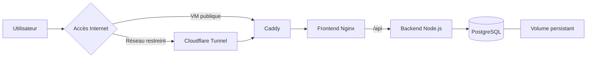

# Atelier — Suivi des interventions

Application pédagogique conteneurisée pour le module **Conteneur et orchestration**.
**Application publique :** [https://atelier-ynov.duckdns.org](https://atelier-ynov.duckdns.org)

Déploiement sur un Droplet DigitalOcean, exposé par Caddy avec un certificat Let’s Encrypt obtenu et renouvelé automatiquement via ACME.


Elle permet de créer, rechercher, modifier et supprimer des demandes d’intervention.

## Architecture



| Service | Image | Rôle |
| --- | --- | --- |
| `frontend` | `ghcr.io/louis-slr/atelier-frontend:1.0.0` | Interface Vite servie par Nginx |
| `backend` | `ghcr.io/louis-slr/atelier-backend:1.0.0` | API Node.js |
| `db` | `postgres:17.6-alpine` | Persistance PostgreSQL |
| `caddy` | `caddy:2.10.2-alpine` | Reverse proxy et HTTPS |
| `cloudflared` | `cloudflare/cloudflared:2026.10.4` | Tunnel temporaire de démonstration |

Le navigateur communique uniquement avec le serveur web. Le backend et PostgreSQL ne publient aucun port sur la machine hôte.

## Prérequis

- Docker avec Docker Compose ;
- Git ;
- accès au registre privé GHCR pour le déploiement ;
- ports 80 et 443 accessibles pour un déploiement direct.

## Lancement local

Créer la configuration locale :

```bash
cp .env.example .env
```

Construire et démarrer les services :

```bash
docker compose up -d --build --wait
```

Ouvrir :

```text
http://localhost:8080
```

Vérifier les services :

```bash
docker compose ps
curl http://localhost:8080/healthz
curl http://localhost:8080/api/health
```

Résultats attendus :

```text
ok
{"status":"ok","database":"connected"}
```

Arrêter les conteneurs :

```bash
docker compose down
```

Le volume `atelier_postgres_data` conserve les demandes après la recréation des conteneurs.

## Tests applicatifs

Backend :

```bash
cd backend
npm ci
npm test
```

Frontend :

```bash
cd frontend
npm ci
npm run build
```

## Construction des images

```bash
docker build -t atelier-backend:local ./backend
docker build -t atelier-frontend:local ./frontend
```

Les deux Dockerfiles utilisent plusieurs étapes afin de ne conserver que les fichiers nécessaires à l’exécution. Les conteneurs applicatifs s’exécutent avec des utilisateurs non-root.

## Publication dans le registre privé

Authentification avec GitHub CLI :

```bash
gh auth token | docker login ghcr.io -u Louis-SLR --password-stdin
```

Construction :

```bash
docker build -t ghcr.io/louis-slr/atelier-backend:1.0.0 ./backend
docker build -t ghcr.io/louis-slr/atelier-frontend:1.0.0 ./frontend
```

Publication :

```bash
docker push ghcr.io/louis-slr/atelier-backend:1.0.0
docker push ghcr.io/louis-slr/atelier-frontend:1.0.0
```

## Déploiement direct sur une VM publique

Préparer la configuration :

```bash
cp .env.production.example .env.production
```

Renseigner dans `.env.production` :

- le domaine public ;
- une adresse électronique valide pour ACME ;
- un mot de passe PostgreSQL aléatoire.

Génération possible du mot de passe :

```bash
openssl rand -hex 32
```

Le domaine doit pointer vers la VM et les ports TCP 80 et 443 doivent être accessibles.

Déployer les images du registre :

```bash
docker compose \
  --env-file .env.production \
  -f compose.prod.yaml \
  pull

docker compose \
  --env-file .env.production \
  -f compose.prod.yaml \
  up -d --no-build --wait
```

Caddy obtient et renouvelle automatiquement le certificat public, puis redirige HTTP vers HTTPS.

## Démonstration depuis un réseau restreint

Le réseau de l’école ne permet pas de rediriger les ports entrants vers le poste. Un Quick Tunnel Cloudflare permet donc une démonstration temporaire.

Préparer la configuration :

```bash
cp .env.tunnel.example .env.tunnel
```

Remplacer le mot de passe PostgreSQL dans `.env.tunnel`, puis lancer :

```bash
docker compose \
  --env-file .env.tunnel \
  -f compose.prod.yaml \
  -f compose.tunnel.yaml \
  pull

docker compose \
  --env-file .env.tunnel \
  -f compose.prod.yaml \
  -f compose.tunnel.yaml \
  up -d --no-build --wait
```

Afficher l’URL publique :

```bash
docker compose \
  --env-file .env.tunnel \
  -f compose.prod.yaml \
  -f compose.tunnel.yaml \
  logs cloudflared
```

Cloudflare fournit une URL temporaire de la forme :

```text
https://exemple.trycloudflare.com
```

Dans ce mode, Cloudflare termine la connexion HTTPS publique et transmet les requêtes par un tunnel sortant. Caddy reste le reverse proxy interne de l’application.

Arrêter la démonstration :

```bash
docker compose \
  --env-file .env.tunnel \
  -f compose.prod.yaml \
  -f compose.tunnel.yaml \
  down
```

## Réseaux et volumes

| Élément | Accès |
| --- | --- |
| Réseau `edge` | Caddy, frontend et tunnel |
| Réseau `application` | Frontend et backend |
| Réseau `database` | Backend et PostgreSQL |
| Volume PostgreSQL | Données applicatives |
| Volume Caddy | Certificats et configuration persistante |

Les réseaux `application` et `database` sont internes. PostgreSQL n’est jamais directement accessible depuis Internet.

## Commandes de diagnostic

```bash
docker compose ps
docker compose logs --tail=100
docker image ls
docker volume ls
docker network ls
```

Consulter un service particulier :

```bash
docker compose logs --tail=100 backend
docker compose logs --tail=100 frontend
docker compose logs --tail=100 db
```

## Attention aux volumes

Cette commande conserve les données :

```bash
docker compose down
```

Cette commande supprime aussi les volumes et les demandes enregistrées :

```bash
docker compose down -v
```

Ne pas utiliser `-v` pendant une démonstration de persistance.

Le mot de passe PostgreSQL est appliqué uniquement lors de la première création du volume. Modifier ensuite le fichier d’environnement ne modifie pas automatiquement le mot de passe de la base existante.

## Limites

- Application pédagogique sans authentification.
- Utiliser uniquement des données fictives.
- Le Quick Tunnel est temporaire et destiné à la démonstration.
- Les fichiers `.env`, `.env.production` et `.env.tunnel` ne doivent jamais être versionnés.
