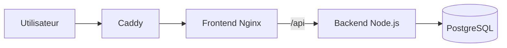

# Atelier — Suivi des interventions

Application web pédagogique réalisée pour le module **Conteneur et orchestration**.

Elle permet de créer, rechercher, modifier et supprimer des demandes d’intervention.

**Application publique : [https://atelier-ynov.duckdns.org](https://atelier-ynov.duckdns.org)**

## Lancer le projet en local

### Prérequis

- Git ;
- Docker Engine ou Docker Desktop ;
- Docker Compose.

Aucun accès à DigitalOcean, DuckDNS ou au registre privé GHCR n’est nécessaire pour le lancement local.

### Installation

```bash
git clone git@github.com:Louis-SLR/Atelier.git
cd Atelier
cp .env.example .env
docker compose up -d --build --wait
```

Ouvrir ensuite :

<http://localhost:8080>

### Vérification

```bash
docker compose ps
curl -sS http://localhost:8080/healthz
curl -sS http://localhost:8080/api/health
```

Résultats attendus :

```text
ok
{"status":"ok","database":"connected"}
```

### Arrêt

```bash
docker compose down
```

Cette commande conserve le volume PostgreSQL et les tickets enregistrés. Ne pas ajouter l’option `-v` sauf si la suppression des données est volontaire.

## Architecture finale



En production, DuckDNS dirige le domaine public vers un Droplet DigitalOcean. Caddy reçoit les connexions HTTP et HTTPS, obtient le certificat Let’s Encrypt par ACME et transmet les requêtes au frontend.

| Service | Rôle |
| --- | --- |
| `frontend` | Interface Vite servie par Nginx non-root |
| `backend` | API Node.js et accès aux données |
| `db` | Base PostgreSQL persistante |
| `caddy` | Reverse proxy public et terminaison HTTPS en production |

Le backend et PostgreSQL ne publient aucun port sur la VM. Les communications passent par des réseaux Docker internes et les données sont conservées dans un volume nommé.

## Tests applicatifs

Node.js et npm sont uniquement nécessaires pour exécuter les tests hors des conteneurs.

Backend :

```bash
(cd backend && npm ci && npm test)
```

Frontend :

```bash
(cd frontend && npm ci && npm run build)
```

## Principaux livrables

- deux Dockerfiles multi-stage pour le frontend et le backend ;
- des images d’exécution utilisant des comptes non-root ;
- un environnement local décrit par `compose.yaml` ;
- un environnement de production décrit par `compose.prod.yaml` ;
- deux images applicatives versionnées dans un registre GHCR privé ;
- des healthchecks pour PostgreSQL, l’API et le frontend ;
- des réseaux Docker segmentés ;
- un volume PostgreSQL persistant ;
- une exposition HTTPS avec Caddy, Let’s Encrypt et ACME.

## Documentation

- [`docs/CONTENEURISATION.md`](docs/CONTENEURISATION.md) : architecture et choix techniques ;
- [`docs/DEPLOIEMENT.md`](docs/DEPLOIEMENT.md) : déploiement et administration de la production ;
- [`docs/VERIFICATION.md`](docs/VERIFICATION.md) : tests et vérifications finales.

## Sécurité et limites

- les fichiers `.env` et `.env.production` ne doivent jamais être versionnés ;
- l’application ne possède pas d’authentification ;
- seules des données fictives doivent être utilisées ;
- Cloudflare Tunnel ne fait pas partie de l’architecture finale.
