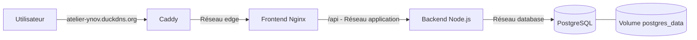

# Atelier — Suivi des interventions

Application web pédagogique réalisée pour le module **Conteneur et orchestration**.

**Application publique : [https://atelier-ynov.duckdns.org](https://atelier-ynov.duckdns.org)**

Atelier permet de créer, rechercher, modifier et supprimer des demandes d’intervention. La version finale est déployée sur un Droplet DigitalOcean et exposée en HTTPS par Caddy.

## Architecture finale



| Service | Image | Rôle |
| --- | --- | --- |
| `caddy` | `caddy:2.10.2-alpine` | Reverse proxy public, HTTPS et renouvellement du certificat |
| `frontend` | `ghcr.io/louis-slr/atelier-frontend:1.0.0` | Interface Vite servie par Nginx non-root |
| `backend` | `ghcr.io/louis-slr/atelier-backend:1.0.0` | API Node.js et accès aux données |
| `db` | `postgres:17.6-alpine` | Base PostgreSQL persistante |

Seul Caddy publie des ports sur la VM : `80` pour HTTP et `443` pour HTTPS. Le frontend, le backend et PostgreSQL communiquent par les réseaux Docker internes.

## Choix de conteneurisation

- les Dockerfiles du frontend et du backend utilisent plusieurs étapes de construction ;
- les images d’exécution ne contiennent que les fichiers nécessaires ;
- le backend s’exécute avec l’utilisateur non-root `node` ;
- le frontend utilise l’image `nginx-unprivileged` ;
- les images applicatives sont versionnées et stockées dans un registre GHCR privé ;
- le fichier Compose de production utilise les images du registre et ne contient aucune directive `build` ;
- des healthchecks contrôlent PostgreSQL, l’API et le frontend ;
- les données PostgreSQL et les données ACME de Caddy sont conservées dans des volumes Docker.

## Arborescence utile

```text
.
├── backend/
│   ├── Dockerfile
│   └── src/
├── frontend/
│   ├── Dockerfile
│   ├── nginx.conf
│   └── src/
├── Caddyfile
├── compose.yaml
├── compose.prod.yaml
├── .env.example
└── .env.production.example
```

## Prérequis

- Docker Engine et Docker Compose ;
- Git ;
- Node.js et npm pour exécuter les tests hors conteneur ;
- accès au registre privé GHCR pour publier ou télécharger les images ;
- une VM publique avec les ports TCP `80` et `443` accessibles pour le déploiement.

## Lancement local

Créer le fichier de configuration locale :

```bash
cp .env.example .env
```

Construire les images et démarrer les services :

```bash
docker compose up -d --build --wait
```

L’application est alors disponible sur :

```text
http://localhost:8080
```

Vérifier son état :

```bash
docker compose ps
curl http://localhost:8080/healthz
curl http://localhost:8080/api/health
```

Résultats attendus :

```text
ok
{"status":"ok","database":"connected"}
```

Arrêter l’environnement local :

```bash
docker compose down
```

Le volume `atelier_postgres_data` est conservé par cette commande.

## Tests applicatifs

Backend :

```bash
cd backend
npm ci
npm test
```

Le backend possède sept tests couvrant notamment le healthcheck, les opérations CRUD, la validation des entrées et l’indisponibilité de PostgreSQL.

Frontend :

```bash
cd frontend
npm ci
npm run build
```

## Construction des images

Images locales :

```bash
docker build -t atelier-backend:local ./backend
docker build -t atelier-frontend:local ./frontend
```

Images destinées au registre :

```bash
docker build -t ghcr.io/louis-slr/atelier-backend:1.0.0 ./backend
docker build -t ghcr.io/louis-slr/atelier-frontend:1.0.0 ./frontend
```

## Publication dans GHCR

S’authentifier avec un jeton GitHub disposant du droit `write:packages` :

```bash
gh auth token | docker login ghcr.io -u Louis-SLR --password-stdin
```

Publier les images :

```bash
docker push ghcr.io/louis-slr/atelier-backend:1.0.0
docker push ghcr.io/louis-slr/atelier-frontend:1.0.0
```

Les deux paquets GHCR sont privés. Une machine de déploiement doit disposer du droit `read:packages` pour les télécharger.

## Déploiement en production

La production utilise :

- un Droplet DigitalOcean sous Ubuntu 24.04 LTS ;
- le domaine `atelier-ynov.duckdns.org` ;
- `compose.prod.yaml` ;
- les images `1.0.0` publiées dans GHCR ;
- Caddy comme reverse proxy et client ACME.

### 1. Préparer la configuration

```bash
cp .env.production.example .env.production
```

Renseigner dans `.env.production` :

```dotenv
DOMAIN=atelier-ynov.duckdns.org
ACME_EMAIL=adresse-valide@example.com
POSTGRES_DB=atelier
POSTGRES_USER=atelier
POSTGRES_PASSWORD=mot-de-passe-long-et-aleatoire
```

Un secret peut être généré avec :

```bash
openssl rand -hex 32
```

Le fichier `.env.production` contient des secrets et ne doit jamais être versionné.

### 2. Préparer la VM

Copier sur la VM les fichiers suivants :

```text
/opt/atelier/compose.prod.yaml
/opt/atelier/Caddyfile
/opt/atelier/.env.production
```

Protéger le fichier d’environnement :

```bash
chmod 600 /opt/atelier/.env.production
```

Le domaine DuckDNS doit résoudre vers l’adresse IPv4 publique de la VM. Les ports `80` et `443` doivent être autorisés par le pare-feu.

### 3. Télécharger et démarrer les images

Après authentification au registre privé :

```bash
cd /opt/atelier

docker compose \
  --env-file .env.production \
  -f compose.prod.yaml \
  pull

docker compose \
  --env-file .env.production \
  -f compose.prod.yaml \
  up -d --no-build --wait
```

Contrôler le résultat :

```bash
docker compose \
  --env-file .env.production \
  -f compose.prod.yaml \
  ps
```

## HTTPS, Let’s Encrypt et ACME

Caddy reçoit les requêtes publiques et transmet le trafic au frontend Nginx.

Au premier démarrage, Caddy :

1. contacte le serveur ACME de production de Let’s Encrypt ;
2. prouve le contrôle du domaine public ;
3. obtient un certificat signé pour `atelier-ynov.duckdns.org` ;
4. sert l’application en HTTPS ;
5. redirige automatiquement HTTP vers HTTPS ;
6. renouvelle le certificat avant son expiration.

Les volumes `caddy_data` et `caddy_config` conservent les informations ACME et les certificats.

## Réseaux et volumes

| Élément | Services ou données | Exposition |
| --- | --- | --- |
| Réseau `edge` | Caddy et frontend | Entrée HTTP et HTTPS |
| Réseau `application` | Frontend et backend | Interne |
| Réseau `database` | Backend et PostgreSQL | Interne |
| Volume `postgres_data` | Données PostgreSQL | Persistant |
| Volume `caddy_data` | Certificats et compte ACME | Persistant |
| Volume `caddy_config` | Configuration persistante de Caddy | Persistant |

PostgreSQL n’est jamais directement accessible depuis Internet.

## Vérifications de production

Depuis un poste client :

```bash
curl -I http://atelier-ynov.duckdns.org
curl -I https://atelier-ynov.duckdns.org
curl -sS https://atelier-ynov.duckdns.org/healthz
curl -sS https://atelier-ynov.duckdns.org/api/health
```

Résultats attendus :

- HTTP répond `308 Permanent Redirect` vers HTTPS ;
- HTTPS répond `200` ;
- `/healthz` répond `ok` ;
- `/api/health` répond `{"status":"ok","database":"connected"}`.

Vérifier le certificat :

```bash
echo | openssl s_client \
  -connect atelier-ynov.duckdns.org:443 \
  -servername atelier-ynov.duckdns.org 2>/dev/null | \
openssl x509 -noout -subject -issuer -dates
```

## Diagnostic et maintenance

Les commandes de production doivent préciser le fichier Compose et le fichier d’environnement :

```bash
cd /opt/atelier

docker compose --env-file .env.production -f compose.prod.yaml ps
docker compose --env-file .env.production -f compose.prod.yaml logs --tail=100
docker compose --env-file .env.production -f compose.prod.yaml logs --tail=100 caddy
docker compose --env-file .env.production -f compose.prod.yaml logs --tail=100 backend
docker stats --no-stream
docker volume ls
docker network ls
```

Mettre à jour le déploiement après la publication de nouvelles images :

```bash
docker compose --env-file .env.production -f compose.prod.yaml pull
docker compose --env-file .env.production -f compose.prod.yaml up -d --no-build --wait
```

## Persistance et suppression

Cette commande supprime les conteneurs et les réseaux, mais conserve les volumes :

```bash
docker compose --env-file .env.production -f compose.prod.yaml down
```

La commande suivante supprime également les données PostgreSQL et les données persistantes de Caddy :

```bash
docker compose --env-file .env.production -f compose.prod.yaml down -v
```

Ne pas utiliser l’option `-v` pendant une démonstration ou sans sauvegarde préalable.

Le mot de passe PostgreSQL est appliqué lors de la première création du volume. Modifier ensuite `.env.production` ne change pas automatiquement le mot de passe stocké dans une base existante.

## Ancienne solution de secours

Les fichiers `compose.tunnel.yaml` et `.env.tunnel.example` correspondent au Quick Tunnel Cloudflare testé avant l’obtention de la VM publique.

**Cloudflare Tunnel ne fait pas partie de l’architecture finale et n’est pas utilisé par le déploiement DigitalOcean.** Ces fichiers sont uniquement conservés comme solution de démonstration de secours.

## Limites

- l’application ne possède pas d’authentification ;
- seules des données fictives doivent être utilisées ;
- la VM est dimensionnée pour une démonstration pédagogique ;
- les sauvegardes PostgreSQL et le déploiement automatisé ne sont pas inclus ;
- les fichiers `.env`, `.env.production` et `.env.tunnel` ne doivent jamais être versionnés.

## Documentation complémentaire

- [`docs/CONTENEURISATION.md`](docs/CONTENEURISATION.md) : architecture et choix de conteneurisation ;
- [`docs/VERIFICATION.md`](docs/VERIFICATION.md) : bilan des tests et vérifications finales.
