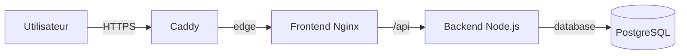

# Déploiement de l’application Atelier

Ce document décrit le déploiement de production sur une VM publique. Pour lancer rapidement le projet sur un poste de travail, suivre uniquement le [`README.md`](../README.md).

## Production actuelle

- application : <https://atelier-ynov.duckdns.org> ;
- hébergement : Droplet DigitalOcean sous Ubuntu 24.04 LTS ;
- orchestration : Docker Compose ;
- images applicatives : registre privé GitHub Container Registry ;
- domaine : DuckDNS ;
- reverse proxy : Caddy ;
- certificat : Let’s Encrypt, obtenu et renouvelé automatiquement par ACME.

L’administration du Droplet, du domaine et du déploiement est réservée aux personnes disposant des accès correspondants. Les utilisateurs et l’intervenant accèdent simplement à l’application avec son URL publique.

Cloudflare Tunnel ne fait pas partie de ce déploiement. Les fichiers relatifs au Quick Tunnel correspondent uniquement à une ancienne solution de démonstration de secours.

## Architecture



Seul Caddy publie les ports `80` et `443`. Le frontend, le backend et PostgreSQL communiquent par des réseaux Docker internes.

| Élément | Utilisation |
| --- | --- |
| `compose.prod.yaml` | Décrit les quatre services de production |
| `Caddyfile` | Configure le domaine, HTTPS et le reverse proxy |
| `.env.production` | Contient le domaine, l’adresse ACME et les secrets PostgreSQL |
| `postgres_data` | Conserve les tickets |
| `caddy_data` | Conserve le compte ACME et les certificats |
| `caddy_config` | Conserve la configuration persistante de Caddy |

## Prérequis

- une VM Ubuntu publique avec Docker Engine et Docker Compose ;
- un domaine résolvant vers l’adresse IPv4 de la VM ;
- les ports TCP `80` et `443` accessibles depuis Internet ;
- un accès SSH d’administration ;
- un accès GHCR disposant du droit `read:packages` ;
- les fichiers `compose.prod.yaml`, `Caddyfile` et `.env.production` dans `/opt/atelier`.

Vérifier Docker sur la VM :

```bash
docker --version
docker compose version
systemctl is-active docker
```

## Premier déploiement

### 1. Préparer le domaine et le pare-feu

Le domaine utilisé dans `DOMAIN` doit résoudre vers l’adresse IPv4 publique de la VM avant le démarrage de Caddy.

Vérification :

```bash
getent ahostsv4 atelier-ynov.duckdns.org | head -1
```

Le pare-feu doit autoriser :

- le port `80/tcp` pour HTTP et la validation ACME ;
- le port `443/tcp` pour HTTPS ;
- le port `22/tcp` uniquement depuis les adresses autorisées à administrer la VM.

Contrôler la configuration :

```bash
ufw status verbose
```

### 2. Préparer la configuration locale

Depuis la racine du dépôt :

```bash
cp .env.production.example .env.production
```

Renseigner les valeurs réelles :

```dotenv
DOMAIN=atelier-ynov.duckdns.org
ACME_EMAIL=adresse-valide@example.com
POSTGRES_DB=atelier
POSTGRES_USER=atelier
POSTGRES_PASSWORD=mot-de-passe-long-et-aleatoire
```

Générer un mot de passe aléatoire :

```bash
openssl rand -hex 32
```

Vérifier que le fichier est ignoré par Git :

```bash
git check-ignore -v .env.production
```

Ne jamais commit, afficher publiquement ou transmettre ce fichier sans canal sécurisé.

### 3. Copier les fichiers sur la VM

Créer le dossier de production :

```bash
ssh root@atelier-ynov.duckdns.org \
  'install -d -m 700 /opt/atelier'
```

Copier les fichiers :

```bash
scp compose.prod.yaml Caddyfile .env.production \
  root@atelier-ynov.duckdns.org:/opt/atelier/
```

Protéger le fichier d’environnement :

```bash
ssh root@atelier-ynov.duckdns.org \
  'chmod 600 /opt/atelier/.env.production'
```

### 4. Authentifier la VM auprès de GHCR

Les images applicatives sont privées. Depuis une machine déjà authentifiée avec GitHub CLI :

```bash
gh auth token | ssh root@atelier-ynov.duckdns.org \
  'docker login ghcr.io -u Louis-SLR --password-stdin'
```

Le jeton doit posséder au minimum le droit `read:packages`.

### 5. Valider et démarrer la production

Se connecter à la VM :

```bash
ssh root@atelier-ynov.duckdns.org
cd /opt/atelier
```

Valider la configuration :

```bash
docker compose \
  --env-file .env.production \
  -f compose.prod.yaml \
  config --quiet
```

Télécharger les images :

```bash
docker compose \
  --env-file .env.production \
  -f compose.prod.yaml \
  pull
```

Démarrer les services :

```bash
docker compose \
  --env-file .env.production \
  -f compose.prod.yaml \
  up -d --no-build --wait --wait-timeout 180
```

Contrôler leur état :

```bash
docker compose \
  --env-file .env.production \
  -f compose.prod.yaml \
  ps
```

Les services `db`, `backend`, `frontend` et `caddy` doivent être démarrés. Les healthchecks contrôlent successivement PostgreSQL, l’API et le frontend.

Après le téléchargement, l’authentification au registre peut être supprimée :

```bash
docker logout ghcr.io
```

Une nouvelle authentification sera alors nécessaire lors du prochain `pull`.

## Vérification publique

Depuis un poste client :

```bash
curl -I http://atelier-ynov.duckdns.org
curl -I https://atelier-ynov.duckdns.org
curl -sS https://atelier-ynov.duckdns.org/healthz
curl -sS https://atelier-ynov.duckdns.org/api/health
```

Résultats attendus :

- HTTP répond `308 Permanent Redirect` vers HTTPS ;
- HTTPS répond `200` ;
- `/healthz` répond `ok` ;
- `/api/health` répond `{"status":"ok","database":"connected"}`.

Vérifier le certificat :

```bash
echo | openssl s_client \
  -connect atelier-ynov.duckdns.org:443 \
  -servername atelier-ynov.duckdns.org 2>/dev/null | \
openssl x509 -noout -subject -issuer -dates
```

Caddy contacte le serveur ACME de production de Let’s Encrypt, obtient le certificat et le renouvelle automatiquement. Les volumes Caddy permettent de conserver le compte ACME et les certificats après la recréation des conteneurs.

## Relancer la VM et l’application

Après avoir rallumé le Droplet depuis DigitalOcean, attendre environ une minute puis se connecter :

```bash
ssh root@atelier-ynov.duckdns.org
```

Vérifier Docker :

```bash
systemctl is-active docker
```

Si nécessaire :

```bash
systemctl enable --now docker
```

Contrôler les services :

```bash
cd /opt/atelier
docker compose --env-file .env.production -f compose.prod.yaml ps
```

La politique `restart: unless-stopped` doit relancer les conteneurs avec Docker. S’ils sont absents ou arrêtés :

```bash
docker compose \
  --env-file .env.production \
  -f compose.prod.yaml \
  up -d --no-build --wait --wait-timeout 180
```

## Publier une nouvelle version

Ne pas remplacer silencieusement le contenu du tag `1.0.0`. Utiliser un nouveau tag, par exemple `1.0.1`.

### 1. Tester le code

```bash
(cd backend && npm ci && npm test)
(cd frontend && npm ci && npm run build)
```

### 2. Construire et publier les images

Depuis la machine de développement :

```bash
gh auth token | docker login ghcr.io -u Louis-SLR --password-stdin

docker build -t ghcr.io/louis-slr/atelier-backend:1.0.1 ./backend
docker build -t ghcr.io/louis-slr/atelier-frontend:1.0.1 ./frontend

docker push ghcr.io/louis-slr/atelier-backend:1.0.1
docker push ghcr.io/louis-slr/atelier-frontend:1.0.1
```

### 3. Mettre à jour Compose

Modifier les deux références d’images dans `compose.prod.yaml` :

```yaml
image: ghcr.io/louis-slr/atelier-backend:1.0.1
image: ghcr.io/louis-slr/atelier-frontend:1.0.1
```

Commit et push cette modification, puis copier le fichier actualisé sur la VM :

```bash
scp compose.prod.yaml \
  root@atelier-ynov.duckdns.org:/opt/atelier/compose.prod.yaml
```

### 4. Mettre à jour la production

Réauthentifier la VM auprès de GHCR, puis exécuter sur la VM :

```bash
cd /opt/atelier

docker compose --env-file .env.production -f compose.prod.yaml config --quiet
docker compose --env-file .env.production -f compose.prod.yaml pull
docker compose --env-file .env.production -f compose.prod.yaml up -d --no-build --wait --wait-timeout 180
docker compose --env-file .env.production -f compose.prod.yaml ps
```

Effectuer ensuite les vérifications publiques. Pour revenir à la version précédente, remettre les anciens tags dans `compose.prod.yaml`, puis refaire `pull` et `up`.

## Diagnostic

```bash
cd /opt/atelier

docker compose --env-file .env.production -f compose.prod.yaml ps
docker compose --env-file .env.production -f compose.prod.yaml logs --tail=100
docker compose --env-file .env.production -f compose.prod.yaml logs --tail=100 db
docker compose --env-file .env.production -f compose.prod.yaml logs --tail=100 backend
docker compose --env-file .env.production -f compose.prod.yaml logs --tail=100 frontend
docker compose --env-file .env.production -f compose.prod.yaml logs --tail=100 caddy

docker stats --no-stream
docker volume ls
docker network ls
free -h
df -h
```

La VM actuelle est volontairement légère. Après un démarrage, laisser aux healthchecks le temps de valider successivement la base, le backend et le frontend.

## Arrêt et persistance

Arrêter les conteneurs tout en conservant les données :

```bash
docker compose \
  --env-file .env.production \
  -f compose.prod.yaml \
  down
```

Ne pas utiliser cette commande sans sauvegarde et sans volonté explicite de supprimer les données :

```bash
docker compose \
  --env-file .env.production \
  -f compose.prod.yaml \
  down -v
```

L’option `-v` supprime les tickets PostgreSQL ainsi que les données persistantes de Caddy.

Le mot de passe PostgreSQL est appliqué lors de la première création du volume. Modifier ensuite `POSTGRES_PASSWORD` dans `.env.production` ne change pas automatiquement le mot de passe déjà enregistré dans PostgreSQL.

## Précautions

- ne jamais versionner `.env.production` ;
- ne jamais partager une clé SSH privée ou un jeton GitHub ;
- attribuer à chaque administrateur sa propre clé publique SSH ;
- limiter le port SSH aux adresses d’administration autorisées ;
- ne pas exposer directement le backend ou PostgreSQL ;
- ne pas exécuter `down -v` pendant une démonstration ;
- ne pas lancer une mise à niveau majeure de la VM juste avant une évaluation ;
- utiliser uniquement des données fictives, car l’application ne possède pas d’authentification.

## Documentation associée

- [`README.md`](../README.md) : lancement local rapide ;
- [`CONTENEURISATION.md`](CONTENEURISATION.md) : architecture et choix techniques ;
- [`VERIFICATION.md`](VERIFICATION.md) : preuves et résultats des tests.
